  

## 👋 Sobre mim

- 🎓 **6º período de Engenharia de Software** na UNESA, campus Itaperuna/RJ
- 💻 Desenvolvo com **Node.js, Express, TypeScript e React**, com dados em **MySQL**
- 🚀 Construí sozinho a **SnakeStore**, um e-commerce full stack com gateway de pagamento, webhooks, WebSockets e deploy em VPS
- 🌱 Aprendendo agora: **Java e Spring Boot** (Bootcamp Itaú na DIO)
- 🔐 Estudo segurança de aplicações (Aceleração Santander de Cibersegurança na DIO)
- 🔭 Buscando **estágio ou vaga júnior** em desenvolvimento backend ou full stack

## 📌 Projetos em destaque

| Projeto | O que é | Stack |
| ------- | ------- | ----- |
| [**secure-auth-backend**](https://github.com/BernardoBoechat/secure-auth-backend) | API de autenticação com JWT em cookie HTTP Only, rota protegida, erros centralizados e testes no CI | Node.js · Express 5 · JWT · bcrypt |
| [**desafio-empresa**](https://github.com/BernardoBoechat/desafio-empresa) | Desafios de processo seletivo: comissões, movimentação de estoque e juros por atraso | Java · Maven · Jackson |
| [**Noir-Profile**](https://github.com/BernardoBoechat/Noir-Profile) | Página "link na bio" minimalista com animações | React · TypeScript · Vite · Tailwind |
| **SnakeStore** *(código privado)* | E-commerce para itens de jogos, com pagamentos, webhooks e atualizações em tempo real | Node.js · TypeScript · MySQL · WebSockets |

## 🛠️ Stack

## 📊 GitHub

  

